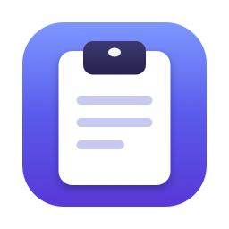
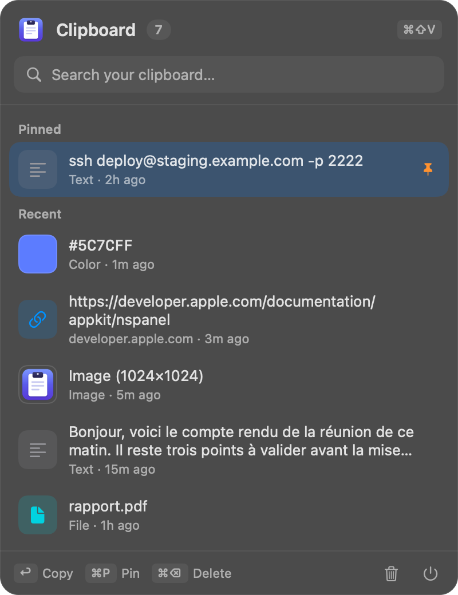

<p align="center">
  
</p>

<h1 align="center">Clipboard Manager</h1>

<p align="center">A lightweight clipboard manager that lives in your Mac's menu bar.</p>

<p align="center">
  
</p>

## Features

- Keeps your copied text, links, colors, images and files
- Opens from anywhere with ⌘⇧V and leaves your current app in front, ready to paste
- Instant search and full keyboard navigation
- Pin the items you use all the time
- Ignores passwords flagged as concealed by password managers
- History stays on your Mac, readable only by your user account
- Light and dark mode

## Install

Download the latest zip from the [Releases](../../releases) page, unzip it and move the app to `/Applications`.

The app isn't notarized, so macOS blocks it the first time. To allow it, try to open it, then go to **System Settings > Privacy & Security** and click **Open Anyway**.

The prebuilt app is for Apple silicon. On an Intel Mac, build it from source.

## Build from source

Requires macOS 13 or later and the Xcode Command Line Tools.

```bash
./build.sh
```

The app is created at `build/Clipboard Manager.app`.

## Shortcuts

| Keys | Action |
| --- | --- |
| ⌘⇧V | Open or close, from anywhere |
| ↑ ↓ | Move through the list |
| ↩ | Copy the selected item |
| ⌘P | Pin or unpin |
| ⌘⌫ | Delete |
| esc | Clear the search, then close |

Right-click the menu bar icon to quit.

## Good to know

- ⌘⇧V replaces "Paste and Match Style" in other apps while Clipboard Manager is running.
- History keeps the last 100 unpinned items. Images are only kept after quitting if they are pinned.

## License

[MIT](LICENSE)
